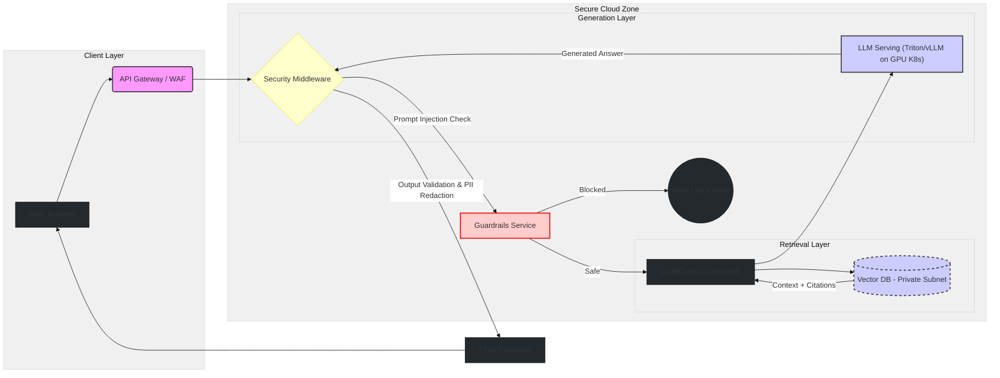

<!-- GitHub Profile · Adrián Infantes · Aligned with LinkedIn (March 2026) -->

<!-- HERO · Dark/Light aware -->

  <picture>
    <source media="(prefers-color-scheme: dark)" srcset="./assets/hero-dark.png">
    <source media="(prefers-color-scheme: light)" srcset="./assets/hero-light.png">
    
  </picture>

<h1 align="center">Adrián Infantes</h1>

  

  <em>I build AI systems knowing exactly how they'll break — and how an adversary will exploit them.</em> 
   
  
  
  
  

---

> **I design, attack and defend AI systems in regulated environments.**
> - **Who:** AI Security & Agent Engineer focused on AI Safety, Alignment & Adversarial Research in Financial Crime (AML, Sanctions, KYC/KYB, Transaction Monitoring).
> - **What:** Red team, harden and deploy LLM/RAG/Agentic platforms on hybrid infrastructure (NVIDIA DGX + Azure/AWS), with real SLAs and audits.
> - **Proof:** 206+ adversarial vectors evaluated, critical findings remediated pre-deploy @BBVA. Kaggle Master. HackTheBox Top 800 Global.

---

## Core Technical Strengths

* **AI Security & Red Teaming:** `MITRE ATLAS` `OWASP LLM Top 10` `PyRIT` `Garak` `Prompt Injection` `Jailbreaks` `Data Exfiltration` `Model Extraction` `Guardrail Bypass` `Threat Modeling`
* **AI Safety & Alignment:** `RLHF` `DPO` `Constitutional AI` `Scalable Oversight` `Mechanistic Interpretability` `Adversarial Robustness`
* **AI Agent Engineering:** `LangGraph` `LangChain` `AutoGen` `ReAct` `Plan-and-Execute` `Tool-use Security` `Sandboxing`
* **NVIDIA Inference & HPC:** `DGX` `TensorRT-LLM` `Triton` `NIM` `CUDA` `cuDNN` `FP8/INT8/AWQ/GPTQ Quantization` `ONNX`
* **MLSecOps:** `Zero Trust` `CI/CD Security Gates` `Trivy` `Cosign` `mTLS` `Kubernetes (AKS/EKS)` `MLflow` `LangSmith`

---

## Impact at a Glance

| Company      | Role                        | Focus                                 | Key Impact |
|-------------|-----------------------------|---------------------------------------|-----------|
| **BBVA**        | AI Security Architect       | Secure Hybrid Cloud, FinCrime AI, Red Teaming | 206+ adversarial vectors, -20% latency, -35% ops costs |
| **BBVA**        | AI/ML Engineer              | Secure RAG, NLP, Fraud & Risk Models  | +22% AUC-ROC credit-risk, +15% retrieval precision, 500k+ guarded queries/month |
| **Ecoembes**    | ML Engineer (Mid)           | Edge CV + Conversational AI           | 85% waste classification, +40% intent accuracy, -25% logistics km |
| **Capgemini**   | Data Scientist (Junior)     | Data lake, forecasting, BI            | +20% forecast accuracy, -30% analysis cycle, 10h/analyst/week saved |

---

## Experience

### BBVA Technology — AI Security Architect | Secure Hybrid Cloud & Intelligence Systems (FinCrime)
**Jan 2026 → Present · Madrid (Hybrid)**

**Context**: Architecting AI Safety infrastructure for sensitive data processing in Financial Crime — AML, KYC/KYB and Transaction Monitoring pipelines — combining NVIDIA (DGX + Triton Inference Server) on-premise with Azure Confidential Computing (TEEs).

* **AI Red Teaming & Threat Modeling** over Agentic Systems, RAG pipelines and LLM applications in production for sanctions screening, fraud detection and KYC due diligence. Adversarial ML evaluated: prompt injection (direct/indirect), multi-turn jailbreaks, data exfiltration, data poisoning, model extraction, tool-use abuse, guardrail bypass, system prompt manipulation. Frameworks: MITRE ATLAS, OWASP Top 10 for LLM Applications. Tools: PyRIT, Garak, custom adversarial harnesses. **Result: 206+ vectors evaluated, critical findings remediated pre-deploy.**
* **AI Safety Architecture (HLD/LLD)**: Isolation controls, end-to-end encryption, GDPR compliance, regulated banking standards (PRA/ECB equivalent), private connectivity (ExpressRoute). **Result: -20% latency, significant risk reduction on critical workloads.**
* **MLSecOps end-to-end**: Security gates in CI/CD, vulnerability scanning (Trivy + Defender for Containers), model artifact signing (Cosign + Notary), drift monitoring with MLflow and LangSmith. Zero Trust: network segmentation, mTLS between services, identity-based access per layer. **Result: -35% operational costs.**

---

### BBVA Technology — AI/ML Engineer | LLMs, RAG, NLP, MLOps
**Jan 2024 → Jan 2026 · 2 years (Remote)**

**Context**: Design, development and deployment of AI systems with integrated AI Safety for regulated financial environments, combining on-premise GPU clusters with AWS (SageMaker, Bedrock).

* **Secure RAG over Foundation Models**: Systems with guardrails (including GraphRAG and Self-RAG) over sensitive documentation — Elasticsearch on-premise + Amazon OpenSearch + vector stores (FAISS, Azure AI Search). Open-weight LLMs (Mistral, LLaMA) optimized with GPTQ/AWQ quantization. **Impact: +15% retrieval precision, -20% latency.**
* **NLP & Voice**: Pipelines processing +10M interactions/year — ASR, diarization, sentiment analysis and intent extraction with Deep Learning. **Impact: +18% CSAT, -35% operational costs.**
* **Fraud & Risk**: Ensemble models (XGBoost + Transformer architectures) for fraud detection and AML on 50K documents/day. Transactional feature engineering + NLP for entity extraction in KYC documentation. **Impact: +22% AUC-ROC.**
* **MLOps & Distributed Training**: End-to-end lifecycle — distributed training in cloud, serving on EKS, tracking with MLflow, drift monitoring and end-to-end traceability. **Impact: -40% time-to-market.**

<h3 align="center">Visualizing a Secure RAG Architecture (Conceptual)</h3>

Isolating ingestion, retrieval, and generation layers with security boundaries.

---

### Ecoembes — Machine Learning Engineer (Mid) | Computer Vision & IoT (Edge + Cloud)
**Feb 2020 → Jan 2024 · 4 years · Madrid (Hybrid)**

**Context**: Hybrid Cloud & Edge AI. Computer Vision on industrial conveyor belts and conversational AI for recycling logistics.

* **Edge CV & Real-time Inference**: Classification system on industrial conveyor belts — models trained in SageMaker, edge inference with ONNX. **Impact: 85% accuracy across 12 waste types, 45K images/hour, latency <100ms.**
* **NLP & Virtual Assistant**: Migrated legacy chatbots to BERT Transformer architectures with embeddings. **Impact: +40% intent accuracy, -40% false positives.**
* **Logistics Optimization**: Route planning algorithms migrated to cloud. **Impact: -25% km driven, -18% annual CO2 footprint.**
* **MLOps**: Training, versioning and deployment pipelines with Docker and CI/CD. **Impact: 90% process automated.**

---

### Capgemini — Data Scientist (Junior) | Cloud Data Analytics & AWS Foundations
**Jan 2019 → Feb 2020 · 1 year 2 months · Las Rozas, Madrid (Hybrid)**

**Context**: Analytics and ML for enterprise clients; data lake on AWS, forecasting, and executive BI.

* **Data Lake & ETL on AWS**: Pipelines in Python and Boto3, consolidating 10+ data sources into Amazon S3. **Impact: -30% analysis cycle time.**
* **Predictive Modeling**: Forecasting models with scikit-learn and statsmodels on Amazon EC2. **Impact: +20% forecast accuracy.**
* **BI & Automation**: Interactive dashboards in QuickSight and Tableau. Serverless reporting with AWS Lambda. **Impact: 10h/analyst/week saved, -35% SQL query response times.**

---

## What I Monitor in Production (The Architect's Dashboard)

1. **Security & Risk:** Prompt injection attempts blocked, PII leakage detection rate, adversarial drift.
2. **Reliability & SLOs:** p95/p99 latency against targets, GPU saturation vs throughput, error budgets.
3. **RAG Quality:** Groundedness score (hallucination check), retrieval precision/recall, citation accuracy.

---

## Tech Stack

  
<b>AI Security & Governance</b>

   

| Category | Technologies |
|---|---|
| **Red Teaming** | MITRE ATLAS, OWASP LLM Top 10, PyRIT, Garak, custom adversarial harnesses, jailbreak test-suites |
| **AI Safety** | RLHF, DPO, Constitutional AI, Scalable Oversight, Mechanistic Interpretability |
| **LLM AppSec** | Prompt Guardrails, security middleware, threat modeling, PII masking pipelines |
| **Compliance** | Audit trails, Azure Confidential Computing (TEEs), end-to-end encryption, mTLS, Zero Trust |

 

  
<b>NVIDIA Inference & HPC</b>

   

| Category | Technologies |
|---|---|
| **Hardware** | DGX, GPU clusters (on-premise + cloud) |
| **Inference** | TensorRT-LLM, Triton Inference Server, NIM |
| **Optimization** | CUDA, cuDNN, FP8/INT8/AWQ/GPTQ quantization, ONNX |
| **Training** | PyTorch Distributed Training on HPC |

 

  
<b>GenAI, Agents & Data</b>

   

| Category | Technologies |
|---|---|
| **Models** | Foundation Models (Mistral, LLaMA), Fine-tuning (QLoRA/LoRA/PEFT) |
| **Orchestration** | LangGraph, LangChain, AutoGen, ReAct, Plan-and-Execute |
| **RAG Stack** | GraphRAG, Self-RAG, FAISS, Azure AI Search, Elasticsearch, cross-encoder re-ranking |
| **MLSecOps** | MLflow, LangSmith, CI/CD security gates, Trivy, Cosign, Kubernetes (AKS/EKS), Docker |
| **Cloud** | AWS (SageMaker, Bedrock, S3, EKS, Lambda), Azure (Confidential Computing, OpenAI, ExpressRoute) |
| **Data Eng** | Python, SQL, PySpark, data lakes / lakehouse architectures |

---

## GitHub Stats

  
  

---

## Toolkit (Quick View)

  
  
  
  
  
  
  
  
  
  

---

## Education

* **BS Double Degree — Computational Mathematics & Computer Science (Specialization: Artificial Intelligence)** — Universidad Camilo José Cela (UCJC).
* **Master's Degree — Gen AI & Deep Learning** — MIOTI | Tech & Business School.

---

## Certifications

* **AWS AI Practitioner** — Amazon Web Services (2026)
* **Claude AI Fluency Framework & Foundations** — Anthropic (2026)

---

## Achievements

* **Kaggle Master** — Top-tier competitive ML ranking.
* **HackTheBox Top 800 Global** (L4tentNoise) — Top 1% Seasonal HTB Hacker.
* **206+ adversarial attack vectors** documented against Foundation Models in production banking environments.

---

## Featured Repositories

| Repo | What it proves | Link |
|------|----------------|------|
| **Spectra — AI Red Teaming Orchestration** | AI-powered attack surface recon with LangGraph + Neo4j graph DB. Scans targets, maps vulnerabilities, AI analyst reasons over the graph. | [`Spectra-LangGraph-AI-Red-Teaming-Orchestration`](https://github.com/infantesromeroadrian/Spectra-LangGraph-AI-Red-Teaming-Orchestration) |
| **SIEM Anomaly Detector ML** | Machine Learning for SIEM anomaly detection — security event analysis at scale. | [`SIEM-Anomaly-Detector-ML`](https://github.com/infantesromeroadrian/SIEM-Anomaly-Detector-ML) |
| **Threat Intelligence ML Detector** | ML-based threat intelligence detection and analysis pipeline. | [`Threat-Intelligence-ML-Detector`](https://github.com/infantesromeroadrian/Threat-Intelligence-ML-Detector) |
| **LangGraph Agents Hospital Center** | Multi-agent system with LangGraph — production-grade agentic architecture. | [`LangGraph-Agents-HospitalCenter`](https://github.com/infantesromeroadrian/LangGraph-Agents-HospitalCenter) |
| **Malware Analysis with LLMs** | LLM-assisted malware analysis in isolated environments with web interface. | [`Malware-Analisys-LLMs`](https://github.com/infantesromeroadrian/Malware-Analisys-LLMs) |
| **WatchDogs Security City** | Security monitoring and analysis platform. | [`WatchDogs-Security-City`](https://github.com/infantesromeroadrian/WatchDogs-Security-City) |

---

## For Hiring Managers & CTOs

- **Roles I fit best:** AI Security Engineer · AI Security Architect · AI Red Team Lead · AI Safety Engineer.
- **Domains where I'm strongest:** Banking, Financial Crime (AML/KYC/Sanctions), regulated environments.
- **What I actually enjoy:** evaluating, attacking and hardening LLM/RAG/Agentic systems in production — not just PoCs.
- **Location / Work mode:** Based in Spain, open to EU/UK-remote; English/Spanish working proficiency.

---

## Collaboration Scope

I'm looking to collaborate on production-grade projects. Let's connect if you are building:

* AI Red Teaming exercises and LLM hardening strategies.
* Secure, multi-agent systems with adversarial evaluation.
* Financial-grade RAG with strict compliance requirements.
* AI Safety research — alignment, interpretability, robustness.

  <a href="mailto:infantesromeroadrian@gmail.com">infantesromeroadrian@gmail.com</a> · <a href="https://www.linkedin.com/in/adrianinfantes">LinkedIn</a> · <a href="https://infantesromeroadrian.github.io/Web-Portfolio-AIR-Terminal/">Portfolio</a>

